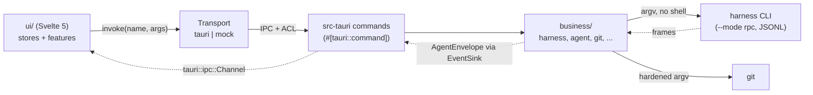
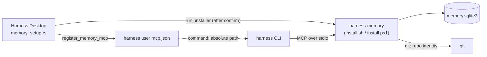
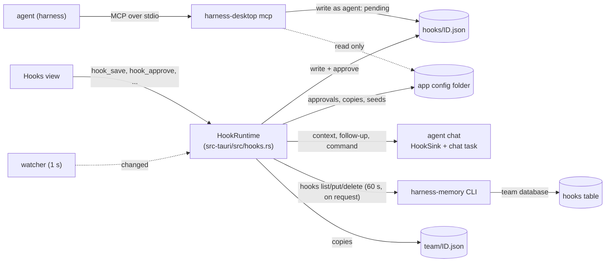

# Architecture

Harness Desktop is a Tauri 2 app in three layers. All domain logic is in a Rust crate that does not depend on Tauri; the
shell and the UI are thin. The project memory MCP server, `harness-memory`, is a separate program in its own repository,
[harness-useful-memory](https://github.com/MSpiechowicz/harness-useful-memory), that the app installs and registers.
The same executable has a second mode, `harness-desktop mcp`, a small MCP server through which agents manage the app's
[hooks](#hooks).

| Layer | Path | Role |
| --- | --- | --- |
| Business | `business/` (crate `harness_business`) | Harness adapters, agent sessions, hooks, git, security, prefs, updater rules. No Tauri dependency, so it is tested without a window. |
| Shell | `src-tauri/` (crate `harness_desktop`) | `#[tauri::command]` adapters, app state, ACL capabilities, CSP, window and lifecycle. |
| UI | `ui/` | Svelte 5 (runes) app, typed IPC client, mock transport, generated bindings and fixtures. |

## Request flow

1. A store or feature calls `ipc.invoke('name', args)` (`ui/src/lib/ipc/client.ts`). `selectTransport` picks the
   Tauri transport when `__TAURI_INTERNALS__` exists, the mock transport in a `VITE_TRANSPORT=mock` build, and a
   transport that always rejects otherwise.
2. The Tauri transport calls `invoke` from `@tauri-apps/api/core`. Function arguments (an `EventSink`) become
   `Channel`s (`ui/src/lib/ipc/tauri-transport.ts`).
3. Tauri checks the capability (`src-tauri/capabilities/main.json`), then runs the `#[tauri::command]` in
   `src-tauri/src/commands/`. The command validates what only the shell can know (the project must be the active or
   a recent one, the harness must be detected, a native dialog produced the path), moves blocking work to
   `spawn_blocking` and calls the business crate.
4. The business crate resolves the binary, spawns the process without a shell and returns a typed result. Errors are
   `BusinessError`s; the shell serializes them as `{ code, message }` (`IpcError`) and replaces every `forbidden`
   message with a generic text (`src-tauri/src/error.rs`). The UI branches on `code`.

### Agent chat stream

`agent_start` takes a `Channel<AgentEnvelope>` (`on_event`) and returns an `AgentSessionInfo` with the session key.
Later calls (`agent_send`, `agent_ui_respond`, `agent_bash`, `agent_stop`) address the session by key.

- Each session is one harness process in `--mode rpc`. Frames are newline-delimited JSON on stdin/stdout
  (`pi_family::rpc::codec`: split on `\n` only, frames up to `MAX_FRAME_BYTES` = 4 MiB, bad frames dropped and
  reported without their content).
- The harness's `RpcDialect` encodes `AgentAction`s into command frames and decodes frames into normalized
  `AgentEvent`s. The webview never sees raw frames.
- One emitter task per session numbers events (`seq`), holds them back until startup completes, and merges text and
  thinking deltas of the same block that arrive within `COALESCE_WINDOW` (16 ms, `agent/coalesce.rs`), so the UI
  renders about once per frame.
- The shell's `ChannelSink` (`src-tauri/src/agent_sink.rs`) implements `EventSink` over the channel. When a send
  fails, the webview is gone and the session is stopped. Every chat but a utility agent gets a `HookSink`
  (`src-tauri/src/hooks/chat.rs`) around it, and `agent_send` goes through `hooks::chat::send` (see [Hooks](#hooks)).
- Stop: close stdin, wait `STOP_GRACE` (3 s), then kill the process group. A page reload stops every session; app
  exit waits for them for at most `EXIT_BUDGET` (`src-tauri/src/lifecycle.rs`). At most `MAX_SESSIONS` (8) run at
  once.

`update_install` uses the same mechanism for download progress (`on_progress: Channel<UpdateProgress>`), and
`sync_import_apply` for the progress of a shared-setup import (`on_progress: Channel<SyncProgress>`).

## Project memory

`harness-memory` gives every harness a shared memory per project plus a global scope. It lives in its own repository
([harness-useful-memory](https://github.com/MSpiechowicz/harness-useful-memory)) and is not part of this app's build or
bundle. The window installs it after the user confirms and registers it; the harnesses run it.

1. **Install.** `harness-memory` is a companion like Harness Dashboard (`Companion::Memory` in
   `business/src/ecosystem/installer.rs`). Recommended setup offers its official installer (the
   release's `install.sh`, or `install.ps1` on Windows, which verify `checksums.txt`) and `setup_install_memory` runs it
   only with `confirmed: true`. It installs to `~/.local/bin/harness-memory` (Linux, macOS) or
   `%LOCALAPPDATA%\Programs\harness-memory\harness-memory.exe` (Windows). `resolve_memory` looks there first, then on
   `PATH` and in the standard install directories (only `.exe` on Windows; on Unix nothing other users may write), and
   `installed_memory` requires `harness-memory --version` to answer `harness-memory <version>` before the server is
   registered or made the migration target. The
   latest version comes from the GitHub releases lookup (`ecosystem_releases`) like the other companions.
2. **Launch.** `memory_setup::spawn_on_launch` runs in the background. While the `memoryEnabled` pref is on and the server
   is installed, for each detected harness with a user `mcp.json` (`mcp_target_paths`) it adds
   `{"command": "<resolved absolute path>", "args": ["mcp"]}`; nothing is registered while the server is missing.
   An existing entry is only touched if it is the app's own (name `harness-memory`, runs `harness-memory mcp`), and then
   only its `command`. `memory-registration.json` records where it was added, so an entry the user removed is not added
   back. Each launch also runs `migrate_legacy_memory` (macOS and Windows): the app's own entries that point at the copy
   older builds kept in `<local data>/bin` are re-pointed at the installed server, and the copy is deleted once nothing
   else uses it (never a symlink, a copy in a symlinked folder, or the installed server's own file). Linux has nothing
   to migrate: that copy was `~/.local/bin/harness-memory`.
3. **Switch.** The Settings switch calls `memory_set_enabled`: it stores the pref, then registers the installed server
   (clearing the record, so the entry returns everywhere) or removes the app's own entries, and returns whether the
   server is installed. After a successful install `after_install` registers. Switching it on or off also makes the
   hooks look up the family members again, and switching it on seeds Harness Memory's hooks (see [Hooks](#hooks)).
   Recommended setup's Harness Memory MCP column registers it in one harness at a time
   (`setup_register_memory`, `memory_setup::register_in`), turning the pref on when it is off. `AppState.memory_setup`
   serializes these runs.
4. **Use.** A harness starts `harness-memory mcp`. The server resolves the repository from `project_path` or its working
   directory with git (normalized `origin`, else the path), then serves eight note and entity tools (`note_save`, `note_update`,
   `note_search`, `note_get`, `note_delete`, `entity_link`, `entity_neighbors`, `entity_delete`) over newline-delimited JSON-RPC. It
   stores notes in SQLite (WAL, FTS5) at `<data>/harness-memory/memory.sqlite3` (`$XDG_DATA_HOME` or `~/.local/share` on
   Linux, `~/Library/Application Support` on macOS, `%LOCALAPPDATA%` on Windows; `HARNESS_MEMORY_DIR` overrides), and
   on first run copies the database older app builds kept under `<local data>/com.mspiechowicz.harness-useful-desktop/memory`
   (the old file stays). The store, the limits per call and the redaction are the server's own; see its repository. The
   desktop app never opens the database itself.
5. **Team database.** Settings can point the server at a shared PostgreSQL, libSQL or MongoDB database instead of the
   local file. `memory_remote_get` / `memory_remote_set` read and write the server's own
   `<config>/harness-memory/config.toml`, or the file `HARNESS_MEMORY_CONFIG` names as for the server (`database_url`, `database_token`, `repository_notes`, `global_notes`,
   `scripts = "local"` only while the installed server keeps scripts, and `trust_team_scripts = true` only while it asks
   before running a script and scripts go to the team database; both kept as saved while the server cannot be asked,
   and `hooks = "remote"` / `trust_team_hooks = true`, see Hooks, team hooks) through
   `business/src/ecosystem/memory_remote/`, returning the URL redacted and the token as a flag; `memory_remote_test` runs
   `harness-memory check` with the typed values in its environment. The app never connects to the database. The hooks
   keys are written only while `harness-memory hooks config --json` answers (`HooksSupport::Supported`,
   `business/src/ecosystem/memory_hooks.rs` over `memory_team_docs.rs`), dropped for a server that answers it with a usage error (exit 2:
   `Unsupported`, it would refuse the file), and kept as saved while the server cannot be asked; trust only while hooks
   are shared. A save re-probes at once (`team_reprobe`), so sharing turned off removes the team copies before
   `memory_remote_set` returns.
6. **Scripts.** Agents save deterministic scripts in the memory store and run them inside the server. The Scripts view
   lists, shows and deletes them through `memory_scripts_list`, `memory_script_get` and `memory_script_delete`
   (`business/src/ecosystem/memory_scripts.rs`), and creates or edits one through `memory_script_save`
   (`memory_scripts_save.rs`: `script_get {name, scope}`, then `script_save` on the pooled server; a taken name is
   `exists` unless the user replaces it, and an edit whose opened version, `base`, is gone or changed is `conflict`;
   nothing is saved then). A saved script the server answers `needed` for (the code of a script waiting for approval)
   is approved with `harness-memory trust` only when the user put the code in and the stored script is the draft: an
   edit that changed the code it opened (line endings and trailing whitespace aside), a replace that does not keep the
   code of the untrusted script it replaces, or a new name. An edit of the description, timeout or language alone stays
   `needed`. A page of the list (offset, 1 to 200 entries, a search of at most 256
   characters, one group of `needsReview`, `repo` or `global`, or else a scope `repo`/`global` combined with a review
   `needed`/`trusted` (a group with either is `invalidInput`), sorted by `updated`, `name`, `language`, `scope`,
   `place`, `runs` or `lastRun`) comes from `harness-memory scripts list --json --offset N --limit N [--query Q]
   [--group G | --scope S --review R] --sort S --order O [--project <root>]` with the total and the count of each
   group, scope (under the query and review) and review (under the query and scope) (`memory_cli.rs`: home directory,
   stdin closed, 15 s, 1 MiB of output kept, the server's last `harness-memory:` line redacted on failure, a usage
   error read as `outdated`). A server that predates combined filters answers no scope or review counts and refuses
   `--scope` and `--review` with a usage error: the list is asked once more without them, and the page says
   `combinedFilters: false` (as it does whenever the answer lacks `scopes`) so the view offers one filter at a time. One pooled
   `harness-memory mcp` in the home directory (`McpPool`, the client the dashboard uses too, stopped after 30 s without
   a call) answers `script_get` and `script_delete` with the authorized project root as `project_path`. A `tools/list`
   probe, cached per binary and modification time, tells whether the server keeps scripts (`script_list` offered):
   `notInstalled` without a binary, `outdated` without the tool, and the paged list also needs a server that asks before
   running a script. A cache miss first stops the pooled server and probes on a fresh one,
   so a binary upgraded in place is not answered for by its old process. The same probe tells whether the server asks
   the user before running a script (its `script_run` takes no `sha`), which makes `trust_team_scripts` a key it knows;
   a `script_run` that is missing or lists no arguments leaves both keys as saved (`ScriptsSupport::Unknown`).
   A summary without `approval` (an older server) gets `approved` or `needed` from `trusted`. The app never opens the
   database and never runs a script.
7. **Script approval.** An agent can never approve a script: the server runs one only when it was saved on this
   machine, the user approved its current version, or `trust_team_scripts = true` and it comes from the team database.
   Otherwise it asks through files in its data folder (`HARNESS_MEMORY_DIR` when absolute, else the platform data
   folder + `harness-memory`, resolved like the server by `memory_requests::memory_data_dir`). While Harness Memory is
   installed and that folder exists, a thread (`src-tauri/src/memory_requests.rs`) touches `desktop.alive` every 5 s
   (removed at exit; the server asks only while it is younger than 15 s) and reads `requests/*.json` every 500 ms
   (`RequestWatcher`: id = 32 lowercase hex, at most 512 KiB, at most 60 s old, version 1). New requests and vanished
   ones reach the page over the channel of `memory_script_requests_listen` (`ScriptRequestEvent`: `request`, `gone`;
   a new listener gets every waiting request again; each carries `receivedAt`, the app's clock at arrival).
   `memory_script_decide` writes `requests/<id>.decision` (`allow`/`deny`, temp file + rename, `0600`) for a request
   the watcher has shown and not answered yet, while the request file exists; the server waits 45 s, then removes
   both, and the watcher removes an answer left alone for more than 60 s. `memory_scripts_trust` runs
   `harness-memory trust <id>=<sha256>… [--project <root>]` (`memory_trust.rs`, 20 s and 1 s per script (120 s at most), home directory, output capped
   and redacted) for the Scripts view's **Trust** buttons; a script changed since the user reviewed it is `conflict`.
8. **Notes.** The Notes view lists, shows and deletes the agents' notes through `memory_notes_list`,
   `memory_note_get` and `memory_note_delete` (`business/src/ecosystem/memory_notes.rs`), each one run of
   `harness-memory notes` as `memory_cli.rs` runs the server's commands (15 s): `notes list --json --offset N --limit N
   [--query Q] [--kind K] [--scope repo|global] --sort updated|title|kind|scope|place --order asc|desc
   [--project <root>]` (the project's repository notes and the global ones, the total, the count of each kind under
   the search and scope, and of each scope under the search and kind; a server that predates combined filters is
   asked once more without `--scope` and the page says `combinedFilters: false`), `notes get <id> --json` (the body and at
   most 50 links, both ways) and `notes delete <id>`. Every one of these commands (and the scripts ones, `trust` included)
   takes the repositories to read instead of `--project`: the Rust `Repos` enum (`memory_cli.rs`) is `--project <root>`, `--repo <key>`
   (one repository wherever it is checked out) or `--all-repos`, sent when a command has `repos` (`MemoryRepos`:
   `all` or `repo` + `key`). The Scope filter of both views (`ui/src/lib/stores/memory-reach.ts`: `all`, `global`,
   `repo:<key>`) picks it and the repositories offered are the projects on this computer (`project_scopes`) plus the ones from `memory_repos_list` (`notes repos --json`, `scripts repos --json`);
   `notes delete --all` and `scripts delete --all` refuse every repository. A script read or deleted outside a project goes through
   the CLI, as the server's MCP tools only see a project's repository. `memory_notes_delete_all` and `memory_scripts_delete_all` run
   `notes delete --all --yes --json [--project <root>]` and `scripts delete --all --yes --json [--project <root>]`
   (60 s): every entry the list shows without filters, answered as `MemoryDeleteAll` (`deleted`, and `team`, how many
   were in the team database). A note the server cannot see from the project is `notFound`. They
   need the server generation the scripts probe calls `Approvals`: an older one, or one that answers a usage error, is
   `outdated`. The app never opens the database. `memory_note_save` creates a note (`note_save`) or edits one by id
   (`note_update`, its scope kept) on the pooled `harness-memory mcp` (`memory_notes_save.rs`); a title another note
   of its scope has is `exists` with that note's id. The server rewrites a same-title global note instead of refusing
   it, so a new global note is looked up first (`memory_notes_titles.rs`): `note_search` with the title as the server
   compares titles, each candidate read with `notes get <id> --json`, and every global note listed 200 at a time when
   the search cannot tell (no letter or digit to search for, or a full page of hits).
   `memory_notes_import_preview` reads a CSV or JSON file from a native open dialog through `SafeReader` (2 MiB, 500
   notes, `memory_notes_import.rs` and `memory_notes_import/parse.rs`) and answers the review (each row's problems as
   codes, and the earlier row with the same title); Rust keeps the rows under a single-use plan id with the project
   (`AppState::notes_import`), and `memory_notes_import_apply` (one at a time) saves the selected row indexes as
   `memory_note_save` does, streaming each row's end over a channel.
9. **Save guards.** The user decides what agents may save, per chat, per project and everywhere. Plan and file
   contract: [plans/memory-save-guards.md](plans/memory-save-guards.md). Reading and recall are never guarded.
   - **Chat.** Every chat gets a random `chatKey` (lowercase UUID v4), and the harness is started with
     `HARNESS_MEMORY_SESSION=<chatKey>` (`SESSION_VAR`, `agent/launch.rs`, after its guards file is written); the
     `harness-memory mcp` child inherits it. Any other launch (a utility agent, a chat without a memory identity) has the
     variable removed, so a value the app itself inherited never names a chat.
     `AgentStartRequest.memoryChat` carries the key and the chat's starting guards (`MemoryChatGuards`: `paused`, and
     `on` and `ask` for notes and for scripts), which the "Ask before saving" defaults `memoryNotesAskDefault` and
     `memoryScriptsAskDefault` seed. A harness whose `memoryChatGuards` capability is false (the MCP child does not get
     the variable) keeps only the repository and global guards and cannot turn Ask on. OMP, PI and OpenCode 1.19.3
     pass it on, checked on Linux.
   - **Files.** `business/src/ecosystem/memory_guards.rs` writes `guards/global.json` (`MemoryGuards`: per kind a
     `paused` flag and the `offRepos`, git roots) and `guards/chats/<chatKey>.json` in the Harness Memory data folder
     (`memory_data_dir`), at chat start and on every toggle (`memory_guards_get`, `memory_guards_update`,
     `memory_chat_guards_set`). The server reads them on every gated call and refuses when one is unreadable. The server
     writes `held/<chatKey>/<heldId>.json` for a save held by Ask, and the app lists and settles those (`memory_held.rs`,
     `memory_held_list`, `memory_held_save`, `memory_held_skip`, event `memory-held-changed`, watched through the
     folder's change stamp) only through `harness-memory held list|save|skip --json`. Nothing here goes into the
     team database.
   - **User-only saves.** The user's own saves (the Notes and Scripts views, the waiting card) run
     `harness-memory notes save|update`, `scripts save` and `held save` (`memory_user_save.rs`) as client
     `harness-desktop`. These commands are not MCP tools, so no guard applies to them. A server without `save-guards`
     in `harness-memory features` has no guards, the app saves through MCP as before and hides the Memory button and
     the Settings cards (`MemoryFeatures.saveGuards`).
   - **Hook.** `ChatHooks::memory_gate` (`src-tauri/src/hooks/chat/memory.rs`) reads the guards at each settle. The
     Harness family hook "Save what you learned" is skipped while the chat is paused or notes and scripts are both off
     for the chat, its repository or everywhere (`MemorySaveGate`, `business/src/hooks/engine/memory_gate.rs`).
     `chat_memory_check_again` sends the hook's text at once through the hook path, and is refused in those states.
   - **UI.** The Memory button in the chat top bar (`ui/src/features/chat/MemoryButton.svelte`) opens a popover with a
     Notes and a Scripts card (this chat, this repository, Ask before saving), Pause and Check again. A waiting card in
     the transcript shows the held saves for Save, Edit or Skip. Settings > Memory has a Notes and a Scripts card
     (`MemoryGuardsCard.svelte`: pause everywhere, the Ask default, repositories without saves).
10. **Vector search and English notes.** Harness Memory can search by meaning as well as by keywords, through one
    local embedder per computer (`harness-memory embedder run`), which every `harness-memory mcp` asks over a local
    socket. The app keeps that process running and never talks to the socket itself.
    - **Files.** `business/src/ecosystem/memory_embedder.rs` holds what the app understands of it: the JSON lines the
      embedder prints (`EmbedderEvent`, `parse_event`), the state they add up to (`EmbedderTracker`, shown as
      `MemoryEmbedderState`: `phase`, `progress`, `model`, `error`) and the short commands `embedder enable|disable`,
      `embedder status --json`, `embedder remove-model` and `settings get|set english_notes=… --json`.
      `memory_embedder_supervisor.rs` runs and restarts the process. `src-tauri/src/memory_embedder.rs` decides when it
      runs and forwards its state, and `src-tauri/src/commands/memory_embedder.rs` holds the commands.
    - **Gating.** `harness-memory features` gates each part: `embedder` (the supervisor, the vector search switch and the
      model removal), `settings` (the English notes setting) and `notes-lang` (`lang` in a note and the `--lang`
      filter, dropped from a query for a server that does not list it). A server without the line answers
      `unsupported`, and Harness Memory not installed answers `notFound`. The page reads the same lines from
      `MemoryRemote` (`embedderSupported`, `settingsSupported`, `notesLangSupported`, next to `saveGuardsSupported`) and
      falls back to a rejected call only while those are not loaded.
    - **Pref.** `vectorSearch` in `prefs.json` (default on, also for a file without the key) is server-managed:
      only `memory_set_vector_search` changes it, because it also runs `embedder enable|disable` and starts or stops the
      process. The embedder is wanted while `memoryEnabled` and `vectorSearch` are both on.
    - **Lifecycle.** `memory_embedder::spawn_on_launch` reconciles at launch, in the background, so the window never
      waits for it. The same reconcile runs after the server's install and after each switch of either pref. It starts
      the process through the tracked spawner (`embedder run` in the home directory, stdin piped and kept open), after
      turning the embedder's own switch on when `embedder status` says it is off. Hiding the window to the tray leaves
      it running. Quit (`lifecycle.rs`) stops it within 5 s: stdin is closed, then 2 s later what is left is killed.
      A crash restarts it after 1, 5 and 30 s, at most three times within ten minutes, then the phase is `failed`.
      An exit 0 on its own leaves it `off`. `{"event":"busy"}` means another app instance runs the embedder, the phase
      is `elsewhere` and it is not started again.
      `MemoryEmbedderState.modelPresent` says whether a downloaded model is on the computer: `embedder status --json`
      (`model_present`) sets it at the launch reconcile and whenever the embedder is stopped on purpose, `ready` makes it
      true, a removal makes it false, and it stays `null` (unknown) when the server does not say.
    - **IPC.** `memory_set_vector_search(enabled)` returns the stored pref and the state. `memory_embedder_watch`
      streams the state over a channel, now and on every change (one listener, a new one replaces the old).
      `memory_embedder_remove_model` deletes the model files and vectors after stopping the embedder.
      `memory_settings_get` and `memory_settings_set` read and write the English notes setting, which the server keeps
      in the store (team-wide on a team database). `memory_notes_list` takes a `lang` filter and `NoteSummary` has `lang`
      (`en`, `other` or none yet), sent as `--lang`.
    - **Hooks.** The Harness family hooks ask agents to search with a few English keywords and to write each note in
      English with 3 to 5 lowercase tags, synonyms included (`hooks/family.rs`).

Older app versions put a `<harness-memory-recall>` block of found notes in front of the first message of a new chat;
the app no longer adds it. Transcripts that hold one still show it as a collapsed chip (`splitRecall`,
`ui/src/lib/chat/memory-recall.ts`, used by `UserMessage.svelte`), and titles, labels and session previews leave it out
(`strip_recall` in `business/src/pi_family/sessions/recall_block.rs`, called by `preview_text`; `firstPrompt` in the
webview).

Privacy rules: [security-privacy.md](security-privacy.md#project-memory).

## Hooks

A hook is a small JSON file that adds context to a prompt, sends a follow-up or runs a shell command when something
happens in a desktop chat. The app window reads the files, shows them in the Hooks view (`ui/src/features/hooks/`) and
runs them. The same executable started as `harness-desktop mcp` lets agents list, add, change and remove hooks, and
never runs one. A team can share hooks through Harness Memory's team database (item 11). The file contract (fields,
limits, events, prompt text, commands, approvals, team hooks) is [hooks-format.md](hooks-format.md). Code:
`business/src/hooks/` (logic, no Tauri; `team/` for team hooks), `business/src/hooks_mcp/` (the MCP mode),
`src-tauri/src/hooks.rs` and `hooks/` (runtime, per-chat tasks, watcher, team refresh), `src-tauri/src/commands/hooks.rs`
and `commands/hooks/team.rs`.

1. **Files.** The hooks root is `HARNESS_HOOKS_DIR` when absolute, else the platform data folder + `harness-hooks`
   (`hooks_root`, mirroring `memory_data_dir`); the files are `<root>/hooks/<id>.json` (`0600`, folder `0700`, id =
   32 lowercase hex). The app's config folder (`config_dir` in `business/src/app_dirs.rs`, the one Tauri's
   `app_config_dir` names, found without Tauri because the MCP mode starts no runtime) holds `hook-approvals.json`,
   `hook-approved/<id>.json`, `hooks-state.json` and `desktop-mcp-registration.json`. `HookStore`
   (`hooks/store.rs`) is the only reader and writer of the hook files in both modes: it lists only regular files named
   exactly `<id>.json` (links and leftovers ignored), ignores the whole folder while group or others can write to it
   (Unix), reads at most 16 KiB + 1 byte of a file (an oversized file is invalid), parses with `parse_hook_file`
   (`format.rs`), and writes by temp file + rename after parsing the bytes it is about to write with the same rules.
   Status (`view.rs`): `pending` until the SHA-256 of the raw bytes equals the approval, then `off`, `paused` (a
   `requires` is not met) or `active`; unreadable, malformed and over-limit files are `invalid` with a reason (at most
   64 hooks per scope, approved ones first, then oldest by `createdAt` then `id`).
2. **Engine.** `HookSession` (`hooks/engine.rs`) is a pure synchronous state machine per chat, with no IO. The shell
   passes it the current `HookSet` (`HookSet::for_chat`: the `active` hooks that are global or of the chat's project root,
   in run order) with every action (`on_send`) and event (`on_event`) and carries out what it returns.
   - `sessionStart`: armed for a chat that starts fresh (`agent_start` without `resume`, not a utility agent); fires
     on the first eligible prompt (`AgentAction::Prompt` without `streamingBehavior` that does not start with `/` or
     `!`). `NewSession` arms it again, `SwitchSession`, `Fork` and `Clone` disarm it; a prompt refused before it reached
     the agent (`send_failed`) leaves it armed. `promptSubmit` fires on every eligible prompt.
   - `toolEnd`: on a matching `ToolEnd` of a run a user message started. A `followUp` hook contributes once per run, a
     command hook runs on every match and its latest output counts.
   - `turnEnd`: on `Settled` of a user run, not on each model turn. Its commands always run (`EventOutcome::TurnCommands`
     when the run earns no follow-up, their output discarded). The loop rule: a follow-up goes out only when a user message
     was delivered since the last settle (any delivered `Prompt`, `Steer` or `FollowUp` from the user), at least one
     `ToolEnd` had `is_error` false, the run was not aborted (`Settled.aborted` or an aborted `PromptResult`) and no
     `PromptResult` was an error. The `turnEnd` parts and the run's collected `toolEnd` parts become one prompt, so a user
     run gets at most one hook follow-up. A settled run waits for `toolEnd` commands still running. A prompt the engine
     sent (`SendOrigin::Hook`) never counts as a user message, and a user message sent before the follow-up goes out
     cancels it (`take_follow_up` ticket).
   - Runs follow the event stream: the shell tells the engine how many `Settled` events the stream delivered
     (`settles_seen`, counted by `HookSink` before they are queued), so a user message sent after a settle the engine
     has not handled yet (the chat task is still running a slow command) belongs to the next run and cancels the
     settled run's follow-up.
   - `sessionEnd`: once per chat, when the agent emits `Exited`; commands only, their output is discarded.
   - A utility agent (titles, reviews) fires nothing.
3. **HookSink and the chat task.** `agent_start` wraps the chat's `ChannelSink` in a `HookSink`
   (`src-tauri/src/hooks/chat.rs`). It forwards every envelope to the webview first, then passes the events the engine
   reads (`ToolEnd` with its result replaced by `null`, `PromptResult`, `Settled`, `Exited`) over an unbounded channel
   to the chat's task (`ChatTask::run`), which handles them in order until `Exited` and runs `toolEnd` commands without
   the chat lock. `HookRuntime::chat(key)` finds the `ChatHooks` of a chat (its `HookSession` behind a tokio mutex, the
   chat lock). `agent_send` goes through `hooks::chat::send`: for a tracked chat's `Prompt`, `Steer` or `FollowUp` it
   takes the lock, asks the engine for context, runs the `sessionStart` and `promptSubmit` commands, puts the context in
   front of the prompt (`compose_prompt`; the last elements are dropped while the result would pass
   `MAX_ACTION_TEXT_BYTES`, and a `sessionStart` context left out entirely arms it again) and sends, and only then lets go, so a later message or a hook follow-up never overtakes
   it. Session-changing actions are sent first and then told to the engine. The follow-up is composed
   (`compose_follow_up`), then sent as a `Prompt` under the lock if `take_follow_up` still holds. A chat is tracked
   from `agent_start` until it stops, its channel closes (`stop_when_closed`), its agent exits or the page reloads
   (`lifecycle::on_page_load` clears the map); `sessionEnd` still fires from `Exited`. The chat's project root is
   `project_identity` of its folder, computed at start and again after `agent_move_project` (`hooks::chat::moved`).
   `HookRuntime` keeps each chat task's handle: app exit waits for them after stopping the agents, at most
   `SESSION_END_BUDGET` (3 s) within `EXIT_BUDGET`, then aborts the rest (dropping a running command kills its shell).
4. **Command execution.** `hooks/command.rs` is, with the companion installers, the one place the app runs a shell:
   `/bin/sh -c <command>` on Linux and macOS, `<SystemRoot>\System32\cmd.exe /D /S /C "<command>"` on Windows (the
   command goes in as `ExecSpec::raw_arg`, unquoted by the runner). Working directory: the project root for a project
   hook, the chat's folder for a global one. Stdin is closed (`ProcessRunner`), the app's environment is inherited and
   `HARNESS_HOOK_EVENT`, `_PROJECT`, `_SESSION`, `_TOOL`, `_TOOL_ERROR` and `_TOUCHED` (at most 16 KiB,
   `MAX_TOUCHED_BYTES`) are added; no tool result or argument is passed. A command has its own `timeoutSecs` (default 10,
   at most 30), the commands of one firing run one after another within `FIRING_BUDGET` (30 s, `run_firing`; the
   `sessionStart` and `promptSubmit` firings of one send each get their own), and the process group is killed on a timeout.
   Stdout is capped at 16 KiB (`max_output_bytes`), trimmed, passed through `redact_text`, and used only when the exit
   code is 0 and something is left; stderr is dropped. A command that gives no output (spawn failure, non-zero exit,
   timeout, skipped for the budget) puts one `Notice` (`NoticeLevel::Warning`) in the chat with the hook's name and the
   cause (`failure_notice`), never the command or its output. Logs carry hook ids, event names and counts.
5. **Approvals.** Only the window approves (`hooks/approvals.rs`, `store.rs`, on the signed document layer
   `business/src/signed_docs/` that keeps the folder, approvals, approved copies, state file and team copies of any
   kind of approved JSON file, hooks being one, `HookKind`). `hook_save` (the window's writes,
   `HookAuthor::Desktop`) writes the file, stores `sha256(bytes)` in `hook-approvals.json` and keeps the approved bytes
   in `hook-approved/<id>.json` (`0600` in a `0700` folder), so it runs at once. A write by the MCP mode
   (`HookAuthor::Agent`) never touches the config folder, so it is `pending` until `hook_approve` stores the hash of the
   exact bytes the user saw (`conflict` when the file changed since). `HookApproval` is `approved`, `changed` (an entry
   with another hash; the view carries the approved copy for the diff) or `never`. `hook_reject` restores the copy of a
   `changed` hook (approved again at once) and deletes a never-approved one. Deleting a hook in the window removes its
   approval and copy; an agent's removal leaves them, and `prune_approvals` drops the approvals and copies of ids with no
   file while the folder is a readable folder.
6. **Runtime and watcher.** `HookRuntime` (`src-tauri/src/hooks.rs`, `AppState.hooks`) holds the optional `HookStore`
   (none on Windows without `LOCALAPPDATA`: `unsupported`), the list read once (`views`, dropped by `invalidate` and when
   the capabilities differ), the tracked chats, the `hooks_listen` channel and one write lock held by every write of the
   app (commands, seeding, pruning), so approvals are never lost to two writers. Capabilities are cached for
   `MEMBERS_TTL` (30 s) and looked up again after an install or the memory switch (`refresh_members`):
   `harness-memory` is met while `installed_memory` finds the server and `memoryEnabled` is on, `harness-dashboard`
   while `resolve_dashboard` finds the dashboard. `hooks/watch.rs` runs a `hooks-watch` thread (`src-tauri/src/doc_watch.rs`) that every 1 s lists
   the hook folder and the approvals file (names, modification times and sizes only; names that start with `.` or do not
   end in `.json` are skipped). The first look only prunes. A change prunes, invalidates the cache and sends
   `HooksEvent::Changed` to the Hooks view, which loads the list again.
7. **Harness family hooks.** `hooks/family.rs` holds the catalog (`FAMILY`): `memory-search` (`sessionStart`
   `addContext`), `memory-save` (`turnEnd` `followUp`), `useful-skills` (`sessionStart` `addContext`, asks the agent
   to read the installed Useful Skills) and `branch-sync` (`sessionStart` `addContext`, asks the agent to fetch and
   compare its branch with the main branch) for Harness Memory, `dashboard-limits` (`sessionStart`
   `addContext`) for Harness Dashboard, each global, `requires` its member and written by the window (approved), marked
   by `seed`. Launch seeding (`hooks::spawn_on_launch`, and `seed_available` again when the memory switch is turned on)
   creates the hooks of every available member once (Harness Memory: installed and its switch on) and records the seed
   in `hooks-state.json`; a recorded seed is never created at launch
   again, and a seed hook already in the folder is recorded, not duplicated. `family_status` gives each entry
   `needsMember` (member not installed, Harness Memory whatever its setting), else `missing` (no valid file with the seed),
   `outdated` (name, event or action differ from the catalog, the user's own edit included) or `installed`.
   `hooks_family_apply` adds missing hooks and brings outdated ones to the catalog (`apply_family`: the id,
   `createdAt`, `createdBy`, scope and `enabled` stay). After the app installed a member (`setup_install_dashboard`,
   `setup_install_memory`, `after_member_install`), `restore_member` adds its missing hooks again, deleted ones
   included, and overwrites none. Uninstalling a member deletes nothing, its hooks show `paused`.
8. **IPC.** `hooks_list` (global hooks and those of `project`, which must be the active or a recent project, else
   `forbidden`; invalid files always; with `all`, the files of every project and every cached team hook, each row
   with its `root` and `repoKey`, a team row matched to a root only when a refresh of this session verified it),
   `project_scopes` (the active and recent projects with their roots and Harness Memory repository keys, the keys
   kept for the session in `ProjectKeys`), `hook_save` (create or edit from a `HookDraft`; a project draft names an
   authorized project folder or the root the edited file already holds; `conflict` when `expectedSha256` differs),
   `hook_delete`, `hook_approve`, `hook_reject`, `hooks_family`, `hooks_family_apply` and `hooks_listen`
   (`Channel<HooksEvent>`), all in `src-tauri/src/commands/hooks.rs`, plus `setup_register_desktop_mcp`
   (`commands/desktop_mcp.rs`).
9. **MCP mode.** `src-tauri/src/main.rs` checks the first argument before anything else: `mcp` runs `run_stdio`
   (`business/src/hooks_mcp/`) with no window, no Tauri runtime and no single-instance check, until stdin closes; in a
   Windows release build (GUI subsystem) it uses the pipes its parent passes. Protocol: newline-delimited JSON-RPC 2.0
   (`protocol.rs`), lines up to `MAX_FRAME_BYTES` (4 MiB, a longer one is answered and skipped), protocol versions
   `2025-11-25`, `2025-06-18`, `2025-03-26`, `2024-11-05`, `serverInfo.name` `harness-desktop`; `-32700`, `-32600`,
   `-32601` and `-32602` for bad JSON, a batch or malformed request, an unknown method and an unknown tool; refusals and
   validation failures are tool results with `isError: true`; nothing a client sends reaches stderr. Tools
   (`tools.rs`, `calls.rs`): `hook_list` (`project`, `scope` `global`, `project` or `all`), `hook_get`, `hook_add`,
   `hook_update` (the `sha256` read last plus only the fields to change) and `hook_remove`. Annotations: `hook_list` and
   `hook_get` `readOnlyHint` and `idempotentHint`; `hook_add` and `hook_update` neither read-only, destructive nor
   idempotent; `hook_remove` `destructiveHint`; all `openWorldHint: false`, each with a title. Agent rules, enforced by
   `HookStore` and not by the tools: a new hook has `createdBy: "agent"`, every write sets `updatedBy: "agent"`, so it is
   pending, an edit or removal needs the current `sha256` (`conflict` otherwise), and `hook_remove` refuses a hook whose
   `createdBy` is not `agent`. `project` defaults to the server's working folder, turned into a project root by
   `project_identity`; a missing or non-folder path is refused. The server reads the approvals to report `approved` or
   `pending`, and checks `requires` against the capabilities found once at start (`resolve_memory` with the `memoryEnabled`
   pref read from `prefs.json`, default on; `resolve_dashboard`). Its instructions tell the agent that a hook it adds or
   changes waits for the user.
10. **Registration.** The app registers the server in the user MCP file of each detected harness under the name
    `harness-desktop` (`business/src/ecosystem/desktop_register.rs`; `{"command": "<absolute path>", "args": ["mcp"]}`,
    OpenCode's shape for its config) with the merge rules of the other entries (`change_file`). The program is the
    AppImage file while the app runs from one (absolute `APPIMAGE`), else the current executable
    (`current_app_command`). At each launch (`src-tauri/src/desktop_mcp.rs`, release builds only: a debug build's
    executable lives in `target/`) the entry is added where nothing runs `harness-desktop mcp`, and an entry the app owns
    (named `harness-desktop`, only argument `mcp`, program the app, the one it wrote last or any `harness-desktop[.exe]`)
    has its `command` re-pointed to the current program, every other field kept. `desktop-mcp-registration.json`
    (`desktop_record.rs`: `{"version": 1, "registered": [{"harness", "file", "command"}]}`, 64 KiB cap, no file
    contents) records the files, so an entry the user removed is not added back; an unusable record is renamed
    `.corrupt-<unix-seconds>` and rebuilt, and nothing is added that launch. The Recommended setup column
    (`HarnessSetup.desktopMcp`, read by `setup_status`) shows the state, and `setup_register_desktop_mcp` adds the entry
    for one harness on request, also where it was removed and in a debug build; the webview sends only the harness id.
11. **Team hooks.** The desktop never connects to the team database: `business/src/ecosystem/memory_hooks.rs` runs
    `harness-memory hooks config|list|put|delete --json` through `memory_cli` (home directory, 15 s, 2 MiB of output,
    a body on stdin for `put`, a failure's `{"error", "message"}` mapped to `conflict`, `notFound`, `invalidInput`,
    `forbidden` or `unsupported`). `MemoryHooks` probes `hooks config` once per binary and config file stamp (the
    file `memory_config_path` finds, `HARNESS_MEMORY_CONFIG` included; a failed probe is not cached). `src-tauri/src/hooks/team.rs` keeps the team state (`TeamHooks`: trust, the last problem,
    when refreshed) and runs a refresh loop through `src-tauri/src/team_sync.rs` (`business/src/signed_docs/team/`
    for the folder): at launch, every `TEAM_REFRESH` (60 s), on `hooks_team_refresh`, after a
    share, a removal or a settings save, and soon after a chat starts in a new project root. A refresh probes; while
    hooks are shared it lists the global scope and the 32 most recent project roots (`fetch_team`; 16 rows a page by
    `nextOffset`, or by the page size for an older answer, at most 16 pages, else the round is incomplete) and
    writes `<root>/team/<id>.json` envelopes and `projects.json` (`apply_round`, under the write lock). Copies no list
    returned are removed per scope: global ones when the global list read every page, those of key `R` when a root
    with key `R` listed every page, and those of a key no root in `projects.json` has. A root that is not a folder is
    skipped and kept in `projects.json` (its copies and approvals survive until it is back), the filesystem root, the
    home folder and roots the server refuses are dropped. A removed copy takes its approval and approved copy with it
    unless a local file has the id. A root's mapping counts (`root_verified`) only after a round of this session
    listed it; a chat or the Hooks view in an unverified root wakes a round. Sharing off, an older server or no
    Harness Memory deletes `<root>/team/` and drops the state, so team hooks stop at once. A server that cannot be
    asked keeps the copies but drops trust (team hooks wait for approval). Only the window reads the folder: `HookStore::list` (the MCP mode) and "Delete all hooks"
    never do. `team_views` (`hooks/team/views.rs`) gives each copy its status (invalid, `duplicate` when a local file
    has the id, `pending` without trust until the body's exact bytes are approved in `hook-approvals.json`, `off` by the
    body or `teamDisabled` in `hooks-state.json`, `paused`, `active`) and `app_listing` appends the team hooks of the
    chat's repository (`projects.json` maps the root to its `git:` key) after the local ones, with `shareBlock` on the
    local ones. `HookSet::with_team` adds the active team hooks after the local ones (team global, then team project,
    run in the chat's root). IPC (`commands/hooks/team.rs`): `hooks_share` (an approved, valid, non-family hook; a
    project hook's `project` rewritten to its repository key from `hooks list --project`; insert, or update with
    `--expect-sha` of the cached team copy; records `sharedFrom`), `hooks_team_remove`, `hooks_team_refresh`,
    `hooks_team_copy` (a local approved hook with the same id, only from a trusted or approved team hook) and `hooks_team_enable` (`teamDisabled`); `hook_approve`
    approves a team hook when no local file has the id.

Privacy rules: [security-privacy.md](security-privacy.md#hooks).

## Business modules

| Module | Purpose |
| --- | --- |
| `harness/` | The `Harness` trait, `HarnessRegistry`, default detection (`detect.rs`), RPC launch helpers (`launch.rs`), the `CommandCatalog` trait (`catalog.rs`), extension CLI actions (`cli.rs`). |
| `harnesses/omp`, `harnesses/pi`, `harnesses/opencode`, `harnesses/claude`, `harnesses/codex` | The adapters: paths, config and extension views, catalogs, dialects, launch, sessions folder, CLI actions. OMP and PI share the PI file and RPC formats (`pi_family/`). OpenCode has JSONC config layers, an Agents category, sessions read through its CLI (`Harness::cli_sessions`) and a native server chat (`chat_protocol` is `ChatProtocol::OpenCodeServer`, `launch_spec` is `opencode serve`, `chat_preview` marks it a preview). OpenCode 1 and OpenCode 2 are one harness: `Harness::note_version` hands the version the probe read to the adapter, which keeps an `OpenCodeGeneration` (`harness/opencode_generation.rs`, `V1` or `V2`, major 2 and later is `V2`, an unknown version `V1`) and reads it in every method that differs (config layers and keys, plugin commands, sessions, MCP shape, `chat_protocol` is `ChatProtocol::OpenCodeServerV2` on `V2`). `Harness::opencode_generation` reports it to the shell, and `ensure_detected` (`src-tauri/src/commands/harness.rs`) detects a harness before views that depend on it. Claude Code has strict-JSON settings layers, a global file (`~/.claude.json`) that only the allow-listed readers open, through `SafeReader::read_claude_global_file` (an exact canonical read of a registered path, 32 MiB), and the app never writes, plugin and marketplace registries (shared with OMP in `harnesses/plugin_registry/`), saved sessions read from its own session files (`<config>/projects/<slug>/<uuid>.jsonl`), plugin and marketplace actions through `claude plugin` (`cli.rs`), MCP servers registered through `claude mcp add-json` (`McpTarget::ClaudeCli`) and a stdio chat (`chat_protocol` is `ChatProtocol::ClaudeStream`, `launch_spec` is `claude` in stream-json mode). Its chat is a preview (`capabilities.chat` and `chatPreview`). Its approval modes are Always ask and Write: `capabilities.yoloMode` is false, so the picker and routine form hide Yolo and a launch asking for it is refused, and `Harness::native_approval_mode` (`modes.rs`) reports its own `permissions.defaultMode` for the chat header and the onboarding notice. `capabilities.projectTrust` and `projectTrustRequired` are true: `Harness::check_project_trust` refuses a chat in a folder without `hasTrustDialogAccepted` unless the launch trusts the project once, and the shell's `Agents` keeps a `TrustMemory` (`agent/trust_memory.rs`) so later chats there in the same app run trust it once too (in memory only, never for a routine run). Rules: [Claude Code](security-privacy.md#claude-code). Plan: [claude-code.md](plans/claude-code.md). Codex has TOML settings layers (`config.toml` of the user and the project, read through `SafeReader` and never written), saved sessions read through a short-lived `codex app-server` per view load (`harnesses/codex/sessions/`, never from its rollout files), plugin and marketplace actions through `codex plugin` (`cli.rs`), MCP servers registered through `codex mcp add` and `remove` (`McpTarget::CodexCli`), a configured mode read from `approval_policy` and `sandbox_mode` (`modes.rs`), Trust once as a `-c projects=…` launch argument (`trust.rs`) and a stdio chat (`chat_protocol` is `ChatProtocol::CodexAppServer`, `launch_spec` is `codex app-server` with its update check off, `chat_preview` marks it a preview). `capabilities.yoloMode` and `projectTrust` are true, `autoMode` and `projectTrustRequired` are false. Rules: [Codex](security-privacy.md#codex). Plan: [codex.md](plans/codex.md). |
| `pi_family/` | Code shared by OMP and PI (OMP is a PI fork): `rpc` (codec, request correlation, `RpcDialect`), `events`, `normalize`, `ui_request`, `touched`, `sessions` (list, tree, transcript, and `recall_block`, which hides the memory recall block older versions added from previews), `config_files`, `frontmatter`, `skills`, `mcp_config`, `resources`. `jsonc` (JSON with comments) and some helpers are also used by OpenCode. |
| `agent/` | `AgentManager` (sessions by key), `AgentSession` (an enum over the chat engines, `engine.rs`), `EventSink`, `DeltaCoalescer`. `RpcSession` (`session.rs`, with `io.rs` and `startup.rs`) speaks the PI-family RPC to OMP and PI. `OpenCodeSession` (`opencode/`) and `OpenCodeV2Session` (`opencode_v2/`) drive one `opencode serve` per chat for OpenCode 1 and OpenCode 2. `ClaudeSession` (`claude/`) drives one `claude` process per chat over stdin and stdout (stream-json and its control protocol): `startup`, `io` (frames and the control-request table), `prompts`, `dialogs` (approvals, questions), `settings`, `ops` (new, switch, fork, clone: a new process each), `relay` (one event stream across processes), `runs` (`!command`, compaction) and `reports` (stats, history, export). `CodexSession` (`codex/`) drives one `codex app-server` per chat over stdin and stdout (JSON-RPC with requests both ways): `startup` (handshake, `thread/start` or `thread/resume`), `io` (frames, the pending-request table, refusals), `prompts`, `dialogs` and `forms` (approvals, questions, elicitations), `approvals` (modes, trust), `settings` and `images`. `AgentProcess` (`process.rs`) is the plumbing the process engines share: spawn, event emitter, redacted rate-limited stderr, the exit watcher that sends `Exited` last, stop (close stdin, grace, kill the group), kill on drop and the startup deadline. `Harness::chat_protocol()` (`ChatProtocol::Rpc(dialect)`, `OpenCodeServer`, `OpenCodeServerV2`, `ClaudeStream` or `CodexAppServer`) picks the engine, and `SessionLaunch` carries it with `resume`, `approval_override` and `utility`. `TrustMemory` (`trust_memory.rs`) remembers the projects trusted once in this app run, for harnesses with `projectTrustRequired`. |
| `opencode_server/` | The OpenCode server side of the native chat, with no process code: `http/` (a hand-written HTTP/1.1 and SSE client on tokio's `TcpStream` for loopback addresses only, Basic auth, size caps, deadlines), `routes.rs` (the closed `Route` allowlist, the only requests the client can make, and checked `ses_`/`msg_`/`per_`/`que_` ids), `wire.rs` (the server's JSON read field by field), `mapper/` (server events and messages as chat events), `modes.rs` (approval modes as permission rules), `mode_config.rs` (those rules as the chat server's `OPENCODE_CONFIG_CONTENT`), `stats.rs` and `export_html.rs`. Rules: [OpenCode chat](security-privacy.md#opencode-chat). Plan and decisions: [opencode-native-chat.md](plans/opencode-native-chat.md). The HTTP client is route-agnostic (`ApiRoute`: method, target, whether it blocks, whether it streams), so `Route` (OpenCode 1) and `RouteV2` share it, with `ServerPassword`, the SSE reader, `export_html` and `stats::usage`. |
| `opencode_server_v2/` | The same for OpenCode 2, whose server API is another one (`/api/...` paths, `{data}` envelopes, a typed event stream, no v1 compatibility): `routes.rs` (the closed `RouteV2` allowlist, directories sent as `location[directory]`, checked ids), `wire/` (envelope, session, catalogs, prompt body), `events/` (the typed event envelope, unknown types ignored), `messages.rs` (the `SessionMessage` union as transcript and history), `tools.rs` (OpenCode 2 tool ids and touched paths), `mapper/` (events as chat events), `modes.rs` (approval modes as `agents.<name>.permissions`), `stats.rs`. The engine is `agent/opencode_v2/` (startup, event stream, prompts, history, settings, approvals, dialogs, ops, runs, reports), one private `opencode serve` per chat like OpenCode 1. Plan and decisions: [opencode-v2.md](plans/opencode-v2.md). |
| `git/` | `GitCli` (hardened git runner), status, branches, diff parsing, untracked files. |
| `review/` | `compose_review`: diff comments into one deterministic Markdown prompt; the UI sends it with `agent_send`. |
| `ecosystem/` | Companion tools: catalog (copyable install steps, never run), detection, a minimal MCP stdio client and the pool that keeps one running (`mcp_pool`), the pooled `harness-dashboard mcp` connection behind the dashboard widgets, Recommended setup (`setup`, `installer`, `mcp_register`) and the atomic `mcp.json` merge it shares with Share setup (`mcp_merge`, whose `change_file` read-decide-write cycle the memory registration also uses). Companions install through `installer` (`Companion`: the dashboard's, the memory server's and the Harness Skills' OpenCode official installers, run after the user confirms). `skills_record` reads the Harness Skills' install record, which is what counts as installed for OpenCode. Project memory setup: `memory_binary` (finding the installed server and its version), `memory_register` (add, update the command of, or remove the `harness-memory` entry), `memory_migrate` (retires the old app copy of the server) and `memory_record` (`memory-registration.json`, so a removed entry stays removed); `memory_remote` (the team database in the server's `config.toml`, and `harness-memory check`); `memory_cli` (one run of a `harness-memory` command for the user, and the page of a list); `memory_notes` (the agents' notes through `harness-memory notes`); `memory_scripts` (the agents' scripts, a page listed with `harness-memory scripts list` and one read through the pooled `harness-memory mcp`); `memory_requests` (the server's data folder, the `desktop.alive` heartbeat, run requests and their answers); `memory_trust` (`harness-memory trust`). The app's own MCP entry: `desktop_register` (add, repoint or read the `harness-desktop` entry that runs `harness-desktop mcp`) and `desktop_record` (`desktop-mcp-registration.json`, so a removed entry stays removed). |
| `sync/` | Share setup: export a harness's marketplaces, plugins, packages and MCP servers as a `hud1:` string or JSON file and import them after a review. `schema` (format v1, limits, per-item parsing), `codec` (zlib + base64url, size caps), `validate` and `secrets` (field checks, redaction), `collect` (export, read from the harnesses' files), `plan` (import review against this machine), `apply` (runs the harness CLIs and the MCP merge, idempotent, no rollback). Harnesses opt in per item kind through `Harness::share_support`. Format: [share-setup.md](share-setup.md). |
| `prefs/`, `project/` | `prefs.json` store (atomic, self-healing), server-managed fields, the active and recent project list. |
| `security/` | Deny-list and `SafeReader` (whose one opt-in read, `SafeReader::read_claude_global_file`, opens Claude Code's global file `.claude.json` only for a path registered by the Claude adapter), redaction, `canonical_within`, `validate_project_dir`, `is_safe_arg`. See [security-privacy.md](security-privacy.md). |
| `process/` | `ProcessRunner` (run to completion), `BlockingRunner` (the same for blocking tasks, `StdRunner`) and `ProcessSpawner` (long-lived child) behind traits; binary resolution without a shell. |
| `hooks/` | Hooks (see [Hooks](#hooks)): `format` (file validation), `store` (the folder: list, save, delete, approve, reject, prune), `approvals` (`hook-approvals.json`, approved copies), `view` (status of each file), `draft` (a `HookDraft` into a hook file), `plan` (`HookSet`, the firings the engine hands the shell), `engine` (`HookSession`, the per-chat state machine), `compose` (context block, follow-up prompt, `strip_hook_context`), `command` (the shell runs of command hooks), `family` (Harness family hooks and their seed record). |
| `hooks_mcp/` | `harness-desktop mcp`: the JSON-RPC protocol (`protocol`), the five tools and their annotations (`tools`), the calls over `HookStore` as an agent (`calls`). |
| `app_dirs.rs` | The app's folders outside Tauri: the config folder (`config_dir`, which the MCP mode needs because it starts no Tauri runtime) and the per-machine data folder (where older builds kept a copy of the bundled memory server, `legacy_memory_copy`). A test checks the identifier against `tauri.conf.json`. |
| `update.rs` | Updater rules independent of Tauri: endpoint, public-key validation, progress reporting. |
| `model/` | The serde + ts-rs DTOs that form the IPC contract. |
| `env.rs` | `Env`: the injected environment. All paths derive from it, so tests run against fixture homes. |
| `testing.rs` | In-memory process doubles (feature `test-support`). |

Shell modules in `src-tauri/src/`: `commands/` (one file per area), `state.rs` (`AppState`), `access.rs` (link
allowlist, reveal roots), `agents.rs`, `agent_sink.rs`, `dialogs.rs` (native pickers), `updates.rs`, `memory_setup.rs`
(project memory registration and old-copy migration at launch), `window.rs` (navigation and pop-up guards), `lifecycle.rs`,
`logging.rs`, `error.rs`, `hooks.rs` and `hooks/` (the runtime, per-chat hook tasks and the folder watcher), `desktop_mcp.rs`
(registering `harness-desktop mcp` in the harnesses at launch).

Share setup in the UI lives in `ui/src/features/sync/`: the Settings section (`SyncSection`), the export and import
dialogs, the review list and the result view, with their state in `sync-export-state` and `sync-import-state`. The
webview never holds a bundle to apply: it sends `sync_import_apply` a plan id and item ids, and Rust keeps the plan
(`sync_plan` in `AppState`, one at a time, and an async mutex so only one apply runs). Native dialogs (`dialogs.rs`)
open the save and open file pickers.

Rules every business module follows: no shell is spawned (the exceptions are the companion installers and the command
hooks of `hooks/command.rs`, which run only text the user wrote or approved), every file read goes through `SafeReader`,
every path is derived from an injected `Env`, and nothing secret reaches the webview unredacted.

## IPC contract

A command exists in six places. `scripts/check-ipc-contract.ts` compares the first two; the rest are enforced by
the compiler or by Tauri's ACL.

| # | Place | Enforced by |
| --- | --- | --- |
| 1 | `#[tauri::command]` fn in `src-tauri/src/commands/` | `check-ipc-contract.ts` (reads every `#[tauri::command]`) |
| 2 | Key in `export const commands` in `ui/src/lib/ipc/commands.ts` | `check-ipc-contract.ts` (1:1 with 1) |
| 3 | `tauri::generate_handler!` in `src-tauri/src/lib.rs` | A command missing here is not callable |
| 4 | `COMMANDS` in `src-tauri/build.rs` | Generates `allow-<command>` permissions (`src-tauri/permissions/autogenerated/`) |
| 5 | `allow-<command>` in `src-tauri/capabilities/main.json` | Tauri ACL: not granted means refused |
| 6 | Handler in the mock scenario (`ui/src/lib/ipc/mock/*-handlers.ts`) | The `Handlers` type requires one handler per `CommandName` |

Generated types:

- **Bindings.** DTOs in `business/src/model/` derive `ts_rs::TS` with `#[ts(export)]`. `cargo test -p
  harness_business export_` writes `ui/src/lib/ipc/bindings/*.ts` (the target comes from `TS_RS_EXPORT_DIR` in
  `.cargo/config.toml`). Never edit these files.
- **Fixtures.** `business/tests/views/mock_fixtures.rs` (`export_mock_fixtures`) writes the JSON served by the mock under
  `ui/src/lib/ipc/mock/fixtures/`: real adapter, git, session and engine output over the synthetic homes in
  `business/tests/fixtures/`, with paths rewritten to `/home/demo/...`; ecosystem and update fixtures are synthetic
  (`business/tests/support/samples/`). The same file asserts that fixtures contain no fixture secret and no machine path.
- **Freshness.** The CI job `Bindings and fixtures are fresh` (Linux call of `business-tests.yml`) runs the `export_`
  tests from the nextest archive and fails on any diff or untracked file under those two directories.

## Testing

| What | How |
| --- | --- |
| Business logic | `cargo test -p harness_business` (CI: `business-tests.yml` builds one `cargo nextest archive` per OS, then shards run it: 3 on Linux, 2 on macOS, 3 on Windows). Four test binaries (`business/tests/{core,engines,setup,views}/main.rs`, one module per test file) share the helpers in `business/tests/support/`. Fixture homes under `business/tests/fixtures`, snapshots with `insta` next to each binary (`business/tests/views/snapshots`). |
| `claude_stream/` | The Claude Code side of the chat, pure code with no process: `wire/` (serde types for the frames and control requests the CLI sends, and the encoders of what the app sends), `mapper/` (`ClaudeMapper`: frames as chat events, tool cards, subagent tasks, asks, the answers the CLI is owed), `tools.rs` (tool ids and the project files a call touched, shared with the Sessions view), `permissions.rs` (approval dialogs and answers, the Always ask hook), `allow_list.rs` (the chat's own "Always allow" answers), `questions.rs` (`AskUserQuestion` dialogs) and `stats.rs`. Rules: [Claude Code](security-privacy.md#claude-code). |
| `codex_rpc/` | The Codex side of the chat, pure code with no process: `wire/` (serde types for only the fields the app uses, taken from the bindings `codex app-server generate-ts` writes, and the encoders of the app's requests and answers), `mapper/` (`CodexMapper`: notifications and server requests as chat events, tool cards in `tools.rs`, approvals and questions in `asks.rs`, turns in `turns.rs`, replies in `replies.rs`) and `stats.rs`. Rules: [Codex](security-privacy.md#codex). |
| Agent sessions | `fake_agent` (`business/src/bin/fake_agent.rs`) plays a JSONL scenario (`business/tests/fixtures/streams/*.jsonl`) as an OMP, PI, OpenCode, Claude Code (`--dialect claude`, replaying recordings of `claude` in `business/tests/fixtures/claude/stream/`), Codex (`--dialect codex`, replaying the scrubbed `codex app-server` recordings in `business/tests/fixtures/codex/app_server/`, made with `record.py` and `scrub.py` next to them) or MCP peer. Tests run the real session engine against it (`business/tests/support/agent_support`). In-memory doubles: `harness_business::testing`. |
| Shell commands | `cargo test -p harness_desktop` spawns `fake_agent`. Without the binary those tests skip; `HARNESS_REQUIRE_FAKE_AGENT=1` (set in CI) makes them fail instead. Build it first: `cargo build -p harness_business --bin fake_agent`. |
| Leaks | Canary tests (`business/tests/views/canary.rs`, `adapter_canary.rs`) hide a marker string in deny-listed files and secret values and fail if any view contains it. |
| UI | Vitest with happy-dom (`bun run test`), component tests with Testing Library. Stores and features run against the mock transport. |
| Browser preview | `bun run dev:mock` serves the UI with the mock transport and no Rust. CI greps `ui/dist` for `__HARNESS_MOCK_TRANSPORT__` so the mock never ships in a production bundle. |
| Live checks | `business/tests/core/live_omp.rs`, `setup/live_ecosystem.rs` and `core/real_home_smoke.rs` exist for manual runs against real tools. |

## Guards

`bun run guard` runs three scripts; `bun run dup` runs jscpd. CI job `guards` runs both, plus `bun run audit`.

- **`check-file-size.ts`**: every authored code file (`.rs .ts .js .mjs .cjs .svelte .css .html .sh .ps1 .yml
  .yaml`) stays within 500 lines. Generated bindings and fixtures, lockfiles, `src-tauri/gen` and
  `src-tauri/icons` are exempt.
- **`check-forbidden.ts`**: rejects patterns by rule id. No opt-out: `--auto-approve`, `"--no-ui"`, OpenCode's
  `"--auto"`, `--yolo`, `--dangerously-skip-permissions` and `--allow-dangerously-skip-permissions`, an `"auth"`/`"providers"` argv followed by `"login"`, shell spawns
  (`Command::new("sh" | "bash" | ... | "pwsh")`; only the companion installers and the command hook runner, on marked
  lines of `business/src/ecosystem/installer.rs` and `business/src/hooks/command.rs`, may name a shell), `innerHTML`/`insertAdjacentHTML`, `eval`/`new Function`, and
  `dangerous...insecure transport` updater settings. In the OpenCode engine files (`business/src/opencode_server/`,
  `agent/opencode/`, `harnesses/opencode/`), also no string literal with a `/share` or `/unshare`, `/global/dispose|upgrade|config`,
  `/auth`, `oauth`, `/provider`, `/experimental`, `/tui` or `/pty` route, no `/config` route that is not a read, no
  `--mdns` without `=false` and no `--port 4096`. In the Claude Code files (`business/src/claude_stream/`,
  `agent/claude/`, `harnesses/claude/`), no `"--bare"` literal. Everywhere, no `--permission-mode bypassPermissions`,
  no `SetPermissionMode` to `bypassPermissions` and no `--permission-prompts none`, all without an opt-out. Opt-out with `guard-allow: <id>` on the same line:
  `--approve` (PI "trust this project once" only), `get_login_providers`, a `"login"` literal, `set_ask_dialog`,
  `{@html}` (sanitized Markdown component only), and `fetch`/`XMLHttpRequest`/`WebSocket`/`EventSource` in
  `ui/src` (the webview must not open connections).
- **`check-ipc-contract.ts`**: the Rust and TypeScript command lists match (see above).
- **`jscpd`** (`.jscpd.json`): duplicate detection from 60 tokens, threshold 0.

Other CI jobs: `cargo fmt --check`, `clippy -D warnings` on both crates, `cargo deny` (`deny.toml`), `svelte-check`,
a UI build, and `tauri build --debug --no-bundle` on Linux, macOS and Windows. Releases are described in
[release-and-updater-keys.md](release-and-updater-keys.md).
