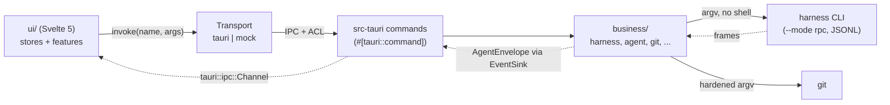

# Architecture

Harness Desktop is a Tauri 2 app in three layers. All domain logic is in a Rust crate that does not depend on
Tauri; the shell and the UI are thin.

| Layer | Path | Role |
| --- | --- | --- |
| Business | `business/` (crate `harness_business`) | Harness adapters, agent sessions, git, security, prefs, updater rules. No Tauri dependency, so it is tested without a window. |
| Shell | `src-tauri/` (crate `harness_desktop`) | `#[tauri::command]` adapters, app state, ACL capabilities, CSP, window and lifecycle. |
| UI | `ui/` | Svelte 5 (runes) app, typed IPC client, mock transport, generated bindings and fixtures. |

## Request flow

1. A store or feature calls `ipc.invoke('name', args)` (`ui/src/lib/ipc/client.ts`). `selectTransport` picks the
   Tauri transport when `__TAURI_INTERNALS__` exists, the mock transport in a `VITE_TRANSPORT=mock` build, and a
   transport that always rejects otherwise.
2. The Tauri transport calls `invoke` from `@tauri-apps/api/core`. Function arguments (an `EventSink`) become
   `Channel`s (`ui/src/lib/ipc/tauri-transport.ts`).
3. Tauri checks the capability (`src-tauri/capabilities/main.json`), then runs the `#[tauri::command]` in
   `src-tauri/src/commands/`. The command validates what only the shell can know (the project must be the active or
   a recent one, the harness must be detected, a native dialog produced the path), moves blocking work to
   `spawn_blocking` and calls the business crate.
4. The business crate resolves the binary, spawns the process without a shell and returns a typed result. Errors are
   `BusinessError`s; the shell serializes them as `{ code, message }` (`IpcError`) and replaces every `forbidden`
   message with a generic text (`src-tauri/src/error.rs`). The UI branches on `code`.

### Agent chat stream

`agent_start` takes a `Channel<AgentEnvelope>` (`on_event`) and returns an `AgentSessionInfo` with the session key.
Later calls (`agent_send`, `agent_ui_respond`, `agent_bash`, `agent_stop`) address the session by key.

- Each session is one harness process in `--mode rpc`. Frames are newline-delimited JSON on stdin/stdout
  (`pi_family::rpc::codec`: split on `\n` only, frames up to `MAX_FRAME_BYTES` = 4 MiB, bad frames dropped and
  reported without their content).
- The harness's `RpcDialect` encodes `AgentAction`s into command frames and decodes frames into normalized
  `AgentEvent`s. The webview never sees raw frames.
- One emitter task per session numbers events (`seq`), holds them back until startup completes, and merges text and
  thinking deltas of the same block that arrive within `COALESCE_WINDOW` (16 ms, `agent/coalesce.rs`), so the UI
  renders about once per frame.
- The shell's `ChannelSink` (`src-tauri/src/agent_sink.rs`) implements `EventSink` over the channel. When a send
  fails, the webview is gone and the session is stopped.
- Stop: close stdin, wait `STOP_GRACE` (3 s), then kill the process group. A page reload stops every session; app
  exit waits for them for at most `EXIT_BUDGET` (`src-tauri/src/lifecycle.rs`). At most `MAX_SESSIONS` (8) run at
  once.

`update_install` uses the same mechanism for download progress (`on_progress: Channel<UpdateProgress>`).

## Business modules

| Module | Purpose |
| --- | --- |
| `harness/` | The `Harness` trait, `HarnessRegistry`, default detection (`detect.rs`), RPC launch helpers (`launch.rs`), the `CommandCatalog` trait (`catalog.rs`), extension CLI actions (`cli.rs`). |
| `harnesses/omp`, `harnesses/pi` | The two adapters: paths, config and extension views, catalogs, dialects, launch, sessions folder, CLI actions. |
| `pi_family/` | Code shared by OMP and PI (OMP is a PI fork): `rpc` (codec, request correlation, `RpcDialect`), `events`, `normalize`, `ui_request`, `touched`, `sessions` (list, tree, transcript), `config_files`, `frontmatter`, `skills`, `mcp_config`, `resources`. |
| `agent/` | `AgentManager` (sessions by key), `AgentSession` (writer, reader, stderr and exit tasks), `EventSink`, `DeltaCoalescer`. |
| `git/` | `GitCli` (hardened git runner), status, branches, diff parsing, untracked files. |
| `review/` | `compose_review`: diff comments into one deterministic Markdown prompt; the UI sends it with `agent_send`. |
| `ecosystem/` | Companion tools: catalog (copyable install steps, never run), detection, a minimal MCP stdio client, and the pooled `harness-dashboard mcp` connection behind the dashboard widgets. |
| `prefs/`, `project/` | `prefs.json` store (atomic, self-healing), server-managed fields, the active and recent project list. |
| `security/` | Deny-list and `SafeReader`, redaction, `canonical_within`, `validate_project_dir`, `is_safe_arg`. See [security-privacy.md](security-privacy.md). |
| `process/` | `ProcessRunner` (run to completion) and `ProcessSpawner` (long-lived child) behind traits; binary resolution without a shell. |
| `update.rs` | Updater rules independent of Tauri: endpoint, public-key validation, progress reporting. |
| `model/` | The serde + ts-rs DTOs that form the IPC contract. |
| `env.rs` | `Env`: the injected environment. All paths derive from it, so tests run against fixture homes. |
| `testing.rs` | In-memory process doubles (feature `test-support`). |

Shell modules in `src-tauri/src/`: `commands/` (one file per area), `state.rs` (`AppState`), `access.rs` (link
allowlist, reveal roots), `agents.rs`, `agent_sink.rs`, `dialogs.rs` (native pickers), `updates.rs`, `window.rs`
(navigation and pop-up guards), `lifecycle.rs`, `logging.rs`, `error.rs`.

Rules every business module follows: no shell is spawned, every file read goes through `SafeReader`, every path is
derived from an injected `Env`, and nothing secret reaches the webview unredacted.

## IPC contract

A command exists in six places. `scripts/check-ipc-contract.ts` compares the first two; the rest are enforced by
the compiler or by Tauri's ACL.

| # | Place | Enforced by |
| --- | --- | --- |
| 1 | `#[tauri::command]` fn in `src-tauri/src/commands/` | `check-ipc-contract.ts` (reads every `#[tauri::command]`) |
| 2 | Key in `export const commands` in `ui/src/lib/ipc/commands.ts` | `check-ipc-contract.ts` (1:1 with 1) |
| 3 | `tauri::generate_handler!` in `src-tauri/src/lib.rs` | A command missing here is not callable |
| 4 | `COMMANDS` in `src-tauri/build.rs` | Generates `allow-<command>` permissions (`src-tauri/permissions/autogenerated/`) |
| 5 | `allow-<command>` in `src-tauri/capabilities/main.json` | Tauri ACL: not granted means refused |
| 6 | Handler in the mock scenario (`ui/src/lib/ipc/mock/*-handlers.ts`) | The `Handlers` type requires one handler per `CommandName` |

Generated types:

- **Bindings.** DTOs in `business/src/model/` derive `ts_rs::TS` with `#[ts(export)]`. `cargo test -p
  harness_business export_` writes `ui/src/lib/ipc/bindings/*.ts` (the target comes from `TS_RS_EXPORT_DIR` in
  `.cargo/config.toml`). Never edit these files.
- **Fixtures.** `business/tests/mock_fixtures.rs` (`export_mock_fixtures`) writes the JSON served by the mock under
  `ui/src/lib/ipc/mock/fixtures/`: real adapter, git, session and engine output over the synthetic homes in
  `business/tests/fixtures/`, with paths rewritten to `/home/demo/...`; ecosystem and update fixtures are synthetic
  (`business/tests/samples/`). The same file asserts that fixtures contain no fixture secret and no machine path.
- **Freshness.** The CI job `bindings-fresh` re-runs `cargo test -p harness_business export_` and fails on any
  diff or untracked file under those two directories.

## Testing

| What | How |
| --- | --- |
| Business logic | `cargo test -p harness_business` (CI: `cargo nextest`, 3 partitions on Linux, plus macOS and Windows). Fixture homes under `business/tests/fixtures`, snapshots with `insta`. |
| Agent sessions | `fake_agent` (`business/src/bin/fake_agent.rs`) plays a JSONL scenario (`business/tests/fixtures/streams/*.jsonl`) as an OMP, PI or MCP peer. Tests run the real session engine against it (`business/tests/agent_support`). In-memory doubles: `harness_business::testing`. |
| Shell commands | `cargo test -p harness_desktop` spawns `fake_agent`. Without the binary those tests skip; `HARNESS_REQUIRE_FAKE_AGENT=1` (set in CI) makes them fail instead. Build it first: `cargo build -p harness_business --bin fake_agent`. |
| Leaks | Canary tests (`business/tests/canary.rs`, `adapter_canary.rs`) hide a marker string in deny-listed files and secret values and fail if any view contains it. |
| UI | Vitest with happy-dom (`bun run test`), component tests with Testing Library. Stores and features run against the mock transport. |
| Browser preview | `bun run dev:mock` serves the UI with the mock transport and no Rust. CI greps `ui/dist` for `__HARNESS_MOCK_TRANSPORT__` so the mock never ships in a production bundle. |
| Live checks | `business/tests/live_omp.rs`, `live_ecosystem.rs` and `real_home_smoke.rs` exist for manual runs against real tools. |

## Guards

`bun run guard` runs three scripts; `bun run dup` runs jscpd. CI job `guards` runs both, plus `bun run audit`.

- **`check-file-size.ts`**: every authored code file (`.rs .ts .js .mjs .cjs .svelte .css .html .sh .ps1 .yml
  .yaml`) stays within 500 lines. Generated bindings and fixtures, lockfiles, `src-tauri/gen` and
  `src-tauri/icons` are exempt.
- **`check-forbidden.ts`**: rejects patterns by rule id. No opt-out: `--auto-approve`, `"--no-ui"`, shell spawns
  (`Command::new("sh" | "bash" | ... | "pwsh")`), `innerHTML`/`insertAdjacentHTML`, `eval`/`new Function`, and
  `dangerous...insecure transport` updater settings. Opt-out with `guard-allow: <id>` on the same line:
  `--approve` (PI "trust this project once" only), `get_login_providers`, a `"login"` literal, `set_ask_dialog`,
  `{@html}` (sanitized Markdown component only), and `fetch`/`XMLHttpRequest`/`WebSocket`/`EventSource` in
  `ui/src` (the webview must not open connections).
- **`check-ipc-contract.ts`**: the Rust and TypeScript command lists match (see above).
- **`jscpd`** (`.jscpd.json`): duplicate detection from 60 tokens, threshold 0.

Other CI jobs: `cargo fmt --check`, `clippy -D warnings` on both crates, `cargo deny` (`deny.toml`), `svelte-check`,
a UI build, and `tauri build --debug --no-bundle` on Linux, macOS and Windows. Releases are described in
[release-and-updater-keys.md](release-and-updater-keys.md).
