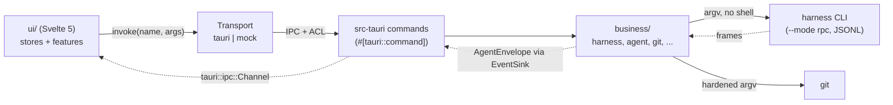
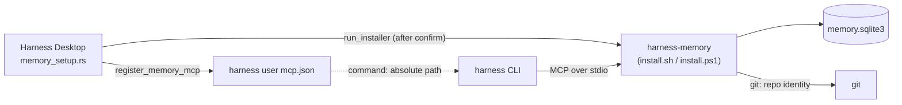

# Architecture

Harness Desktop is a Tauri 2 app in three layers. All domain logic is in a Rust crate that does not depend on Tauri; the
shell and the UI are thin. The project memory MCP server, `harness-memory`, is a separate program in its own repository,
[harness-useful-memory](https://github.com/MSpiechowicz/harness-useful-memory), that the app installs and registers.

| Layer | Path | Role |
| --- | --- | --- |
| Business | `business/` (crate `harness_business`) | Harness adapters, agent sessions, git, security, prefs, updater rules. No Tauri dependency, so it is tested without a window. |
| Shell | `src-tauri/` (crate `harness_desktop`) | `#[tauri::command]` adapters, app state, ACL capabilities, CSP, window and lifecycle. |
| UI | `ui/` | Svelte 5 (runes) app, typed IPC client, mock transport, generated bindings and fixtures. |

## Request flow

1. A store or feature calls `ipc.invoke('name', args)` (`ui/src/lib/ipc/client.ts`). `selectTransport` picks the
   Tauri transport when `__TAURI_INTERNALS__` exists, the mock transport in a `VITE_TRANSPORT=mock` build, and a
   transport that always rejects otherwise.
2. The Tauri transport calls `invoke` from `@tauri-apps/api/core`. Function arguments (an `EventSink`) become
   `Channel`s (`ui/src/lib/ipc/tauri-transport.ts`).
3. Tauri checks the capability (`src-tauri/capabilities/main.json`), then runs the `#[tauri::command]` in
   `src-tauri/src/commands/`. The command validates what only the shell can know (the project must be the active or
   a recent one, the harness must be detected, a native dialog produced the path), moves blocking work to
   `spawn_blocking` and calls the business crate.
4. The business crate resolves the binary, spawns the process without a shell and returns a typed result. Errors are
   `BusinessError`s; the shell serializes them as `{ code, message }` (`IpcError`) and replaces every `forbidden`
   message with a generic text (`src-tauri/src/error.rs`). The UI branches on `code`.

### Agent chat stream

`agent_start` takes a `Channel<AgentEnvelope>` (`on_event`) and returns an `AgentSessionInfo` with the session key.
Later calls (`agent_send`, `agent_ui_respond`, `agent_bash`, `agent_stop`) address the session by key.

- Each session is one harness process in `--mode rpc`. Frames are newline-delimited JSON on stdin/stdout
  (`pi_family::rpc::codec`: split on `\n` only, frames up to `MAX_FRAME_BYTES` = 4 MiB, bad frames dropped and
  reported without their content).
- The harness's `RpcDialect` encodes `AgentAction`s into command frames and decodes frames into normalized
  `AgentEvent`s. The webview never sees raw frames.
- One emitter task per session numbers events (`seq`), holds them back until startup completes, and merges text and
  thinking deltas of the same block that arrive within `COALESCE_WINDOW` (16 ms, `agent/coalesce.rs`), so the UI
  renders about once per frame.
- The shell's `ChannelSink` (`src-tauri/src/agent_sink.rs`) implements `EventSink` over the channel. When a send
  fails, the webview is gone and the session is stopped.
- Stop: close stdin, wait `STOP_GRACE` (3 s), then kill the process group. A page reload stops every session; app
  exit waits for them for at most `EXIT_BUDGET` (`src-tauri/src/lifecycle.rs`). At most `MAX_SESSIONS` (8) run at
  once.

`update_install` uses the same mechanism for download progress (`on_progress: Channel<UpdateProgress>`), and
`sync_import_apply` for the progress of a shared-setup import (`on_progress: Channel<SyncProgress>`).

## Project memory

`harness-memory` gives every harness a shared memory per repository plus a global scope. It lives in its own repository
([harness-useful-memory](https://github.com/MSpiechowicz/harness-useful-memory)) and is not part of this app's build or
bundle. The window installs it after the user confirms and registers it; the harnesses run it, and the window runs it
once more for the recall of notes in a new chat (step 5).

1. **Install.** `harness-memory` is a companion like Harness Dashboard (`Companion::Memory` in
   `business/src/ecosystem/installer.rs`). Recommended setup offers its official installer (the
   release's `install.sh`, or `install.ps1` on Windows, which verify `checksums.txt`) and `setup_install_memory` runs it
   only with `confirmed: true`. It installs to `~/.local/bin/harness-memory` (Linux, macOS) or
   `%LOCALAPPDATA%\Programs\harness-memory\harness-memory.exe` (Windows). `resolve_memory` looks there first, then on
   `PATH` and in the standard install directories (only `.exe` on Windows; on Unix nothing other users may write), and
   `installed_memory` requires `harness-memory --version` to answer `harness-memory <version>` before the server is
   registered, recalled or made the migration target. The
   latest version comes from the GitHub releases lookup (`ecosystem_releases`) like the other companions.
2. **Launch.** `memory_setup::spawn_on_launch` runs in the background. While the `memoryEnabled` pref is on and the server
   is installed, for each detected harness with a user `mcp.json` (`mcp_target_paths`) it adds
   `{"command": "<resolved absolute path>", "args": ["mcp"]}`; nothing is registered while the server is missing.
   An existing entry is only touched if it is the app's own (name `harness-memory`, runs `harness-memory mcp`), and then
   only its `command`. `memory-registration.json` records where it was added, so an entry the user removed is not added
   back. Each launch also runs `migrate_legacy_memory` (macOS and Windows): the app's own entries that point at the copy
   older builds kept in `<local data>/bin` are re-pointed at the installed server, and the copy is deleted once nothing
   else uses it (never a symlink, a copy in a symlinked folder, or the installed server's own file). Linux has nothing
   to migrate: that copy was `~/.local/bin/harness-memory`.
3. **Switch.** The Settings switch calls `memory_set_enabled`: it stores the pref, then registers the installed server
   (clearing the record, so the entry returns everywhere) or removes the app's own entries, and returns whether the
   server is installed. After a successful install `after_install` refreshes the
   recall server and registers. Recommended setup's Harness Memory MCP column registers it in one harness at a time
   (`setup_register_memory`, `memory_setup::register_in`), turning the pref on when it is off. `AppState.memory_setup`
   serializes these runs.
4. **Use.** A harness starts `harness-memory mcp`. The server resolves the repository from `project_path` or its working
   directory with git (normalized `origin`, else the path), then serves seven tools (`memory_remember`, `memory_update`,
   `memory_search`, `memory_get`, `memory_link`, `memory_neighbors`, `memory_forget`) over newline-delimited JSON-RPC. It
   stores notes in SQLite (WAL, FTS5) at `<data>/harness-memory/memory.sqlite3` (`$XDG_DATA_HOME` or `~/.local/share` on
   Linux, `~/Library/Application Support` on macOS, `%LOCALAPPDATA%` on Windows; `HARNESS_MEMORY_DIR` overrides), and
   on first run copies the database older app builds kept under `<local data>/com.mspiechowicz.harness-useful-desktop/memory`
   (the old file stays). The store, the limits per call and the redaction are the server's own; see its repository. The
   desktop app never opens the database itself.
5. **Recall.** `agent_send` goes through `memory_recall::send` (`src-tauri/src/memory_recall.rs`). `agent_start` tracks
   every chat but a utility agent (`memory_recall::track`) and arms a new one (not resumed); a successful `NewSession`
   arms a tracked chat again. `RecallGate` keeps one slot per chat. While `memoryEnabled` and `memoryRecall` are on,
   arming also warms up the installed server (`AppState.memory_server`, from `resolve_memory` once it reports its version;
   until it is installed on macOS and Windows, the old copy in `<local data>/bin` serves, under the same check) with `mcp` in the chat's project directory, in the background; a warm server unused for 60 s
   (`WARM_IDLE`) is stopped, and at most four (`WARM_MAX`) run at once, the oldest stopped first. The first message decides under the slot's lock: an `AgentAction::Prompt`
   without `streamingBehavior` that does not start with `/` or `!` goes to `MemoryRecall::recall`
   (`business/src/ecosystem/memory_recall.rs`); steers, follow-ups and queued prompts, and `SwitchSession`, `Fork` and
   `Clone`, only disarm; a first message the agent refuses arms the chat again. `recall_query` builds the keywords
   (`recall_text.rs`), `memory_search` runs with limit 5, scope `repo` and `same_checkout: true` (only notes last
   written from this checkout without `project_path`) inside a 1.5 s limit, and `recall_block_with` prepends a
   `<harness-memory-recall>` block of at most 2304 bytes: the notes (at most 1536) and, after them, the saved scripts
   the same reply lists (`<saved-scripts>` block or `structuredContent.scripts`, read by `recall_scripts.rs`, at most
   five and 768 bytes) under their own framing line. Scripts cost no second call. A reply whose scripts cannot be read
   recalls the notes alone. Any failure sends the message as written; the log carries
   only the outcome kind and the note and script counts. Stopping a chat (or its channel closing) forgets the slot and kills the
   warm server; a page reload forgets every slot (`lifecycle::on_page_load`). In the webview `splitRecall`
   (`ui/src/lib/chat/memory-recall.ts`) turns the block into a collapsed chip in `UserMessage.svelte`, and titles, labels
   and session previews strip it (`strip_recall`, `preview_text`, `firstPrompt`). The Settings row **Add memory to new
   chats** sets the UI-managed `memoryRecall` pref.
6. **Team database.** Settings can point the server at a shared PostgreSQL, libSQL or MongoDB database instead of the
   local file. `memory_remote_get` / `memory_remote_set` read and write the server's own
   `<config>/harness-memory/config.toml` (`database_url`, `database_token`, `repository_notes`, `global_notes`,
   `scripts = "local"` only while the installed server keeps scripts, and `trust_team_scripts = true` only while it asks
   before running a script and scripts go to the team database; both kept as saved while the server cannot be asked) through
   `business/src/ecosystem/memory_remote/`, returning the URL redacted and the token as a flag; `memory_remote_test` runs
   `harness-memory check` with the typed values in its environment. The app never connects to the database.
7. **Scripts.** Agents save deterministic scripts in the memory store and run them inside the server. The Memory view
   lists, shows and deletes them through `memory_scripts_list`, `memory_script_get` and `memory_script_delete`
   (`business/src/ecosystem/memory_scripts.rs`). A page of the list (offset, 1 to 200 entries, a search of at most 256
   characters, one group of `needsReview`, `repo` or `global`, sorted by `updated`, `name`, `language`, `scope`,
   `place`, `runs` or `lastRun`) comes from `harness-memory
   scripts list --json --offset N --limit N [--query Q] [--group G] --sort S --order O [--project <root>]` with the
   total and the count of each group (`memory_cli.rs`: home directory, stdin closed, 15 s, 1 MiB of output kept, the
   server's last `harness-memory:` line redacted on failure, a usage error read as `outdated`). One pooled
   `harness-memory mcp` in the home directory (`McpPool`, the client the dashboard uses too, stopped after 30 s without
   a call) answers `script_get` and `script_delete` with the authorized project root as `project_path`. A `tools/list`
   probe, cached per binary and modification time, tells whether the server keeps scripts (`script_list` offered):
   `notInstalled` without a binary, `outdated` without the tool, and the paged list also needs a server that asks before
   running a script. A cache miss first stops the pooled server and probes on a fresh one,
   so a binary upgraded in place is not answered for by its old process. The same probe tells whether the server asks
   the user before running a script (its `script_run` takes no `sha`), which makes `trust_team_scripts` a key it knows;
   a `script_run` that is missing or lists no arguments leaves both keys as saved (`ScriptsSupport::Unknown`).
   A summary without `approval` (an older server) gets `approved` or `needed` from `trusted`. The app never opens the
   database and never runs a script.
8. **Script approval.** An agent can never approve a script: the server runs one only when it was saved on this
   machine, the user approved its current version, or `trust_team_scripts = true` and it comes from the team database.
   Otherwise it asks through files in its data folder (`HARNESS_MEMORY_DIR` when absolute, else the platform data
   folder + `harness-memory`, resolved like the server by `memory_requests::memory_data_dir`). While Harness Memory is
   installed and that folder exists, a thread (`src-tauri/src/memory_requests.rs`) touches `desktop.alive` every 5 s
   (removed at exit; the server asks only while it is younger than 15 s) and reads `requests/*.json` every 500 ms
   (`RequestWatcher`: id = 32 lowercase hex, at most 512 KiB, at most 60 s old, version 1). New requests and vanished
   ones reach the page over the channel of `memory_script_requests_listen` (`ScriptRequestEvent`: `request`, `gone`;
   a new listener gets every waiting request again; each carries `receivedAt`, the app's clock at arrival).
   `memory_script_decide` writes `requests/<id>.decision` (`allow`/`deny`, temp file + rename, `0600`) for a request
   the watcher has shown and not answered yet, while the request file exists; the server waits 45 s, then removes
   both, and the watcher removes an answer left alone for more than 60 s. `memory_scripts_trust` runs
   `harness-memory trust <id>=<sha256>… [--project <root>]` (`memory_trust.rs`, 20 s and 1 s per script (120 s at most), home directory, output capped
   and redacted) for the Memory view's **Trust** buttons; a script changed since the user reviewed it is `conflict`.
9. **Notes.** The Memory view lists, shows and deletes the agents' notes through `memory_notes_list`,
   `memory_note_get` and `memory_note_delete` (`business/src/ecosystem/memory_notes.rs`), each one run of
   `harness-memory notes` as `memory_cli.rs` runs the server's commands (15 s): `notes list --json --offset N --limit N
   [--query Q] [--kind K] --sort updated|title|kind|scope|place --order asc|desc [--project <root>]` (the project's
   repository notes and the global ones, the total and the count of each kind under the search), `notes get <id> --json` (the body and at
   most 50 links, both ways) and `notes delete <id>`. `memory_notes_delete_all` and `memory_scripts_delete_all` run
   `notes delete --all --yes --json [--project <root>]` and `scripts delete --all --yes --json [--project <root>]`
   (60 s): every entry the list shows without filters, answered as `MemoryDeleteAll` (`deleted`, and `team`, how many
   were in the team database). A note the server cannot see from the project is `notFound`. They
   need the server generation the scripts probe calls `Approvals`: an older one, or one that answers a usage error, is
   `outdated`. The app never opens the database.

Privacy rules: [security-privacy.md](security-privacy.md#project-memory).

## Business modules

| Module | Purpose |
| --- | --- |
| `harness/` | The `Harness` trait, `HarnessRegistry`, default detection (`detect.rs`), RPC launch helpers (`launch.rs`), the `CommandCatalog` trait (`catalog.rs`), extension CLI actions (`cli.rs`). |
| `harnesses/omp`, `harnesses/pi`, `harnesses/opencode` | The adapters: paths, config and extension views, catalogs, dialects, launch, sessions folder, CLI actions. OMP and PI share the PI file and RPC formats (`pi_family/`). OpenCode has JSONC config layers, an Agents category, sessions read through its CLI (`Harness::cli_sessions`) and no chat yet (`capabilities.chat` is false, `launch_spec` is `Unsupported`). |
| `pi_family/` | Code shared by OMP and PI (OMP is a PI fork): `rpc` (codec, request correlation, `RpcDialect`), `events`, `normalize`, `ui_request`, `touched`, `sessions` (list, tree, transcript), `config_files`, `frontmatter`, `skills`, `mcp_config`, `resources`. `jsonc` (JSON with comments) and some helpers are also used by OpenCode. |
| `agent/` | `AgentManager` (sessions by key), `AgentSession` (writer, reader, stderr and exit tasks), `EventSink`, `DeltaCoalescer`. |
| `git/` | `GitCli` (hardened git runner), status, branches, diff parsing, untracked files. |
| `review/` | `compose_review`: diff comments into one deterministic Markdown prompt; the UI sends it with `agent_send`. |
| `ecosystem/` | Companion tools: catalog (copyable install steps, never run), detection, a minimal MCP stdio client and the pool that keeps one running (`mcp_pool`), the pooled `harness-dashboard mcp` connection behind the dashboard widgets, Recommended setup (`setup`, `installer`, `mcp_register`) and the atomic `mcp.json` merge it shares with Share setup (`mcp_merge`, whose `change_file` read-decide-write cycle the memory registration also uses). Companions install through `installer` (`Companion`: the dashboard's and the memory server's official installers, run after the user confirms). Project memory setup: `memory_binary` (finding the installed server and its version), `memory_register` (add, update the command of, or remove the `harness-memory` entry), `memory_migrate` (retires the old app copy of the server) and `memory_record` (`memory-registration.json`, so a removed entry stays removed); `memory_remote` (the team database in the server's `config.toml`, and `harness-memory check`); `memory_cli` (one run of a `harness-memory` command for the user, and the page of a list); `memory_notes` (the agents' notes through `harness-memory notes`); `memory_scripts` (the agents' scripts, a page listed with `harness-memory scripts list` and one read through the pooled `harness-memory mcp`); `memory_requests` (the server's data folder, the `desktop.alive` heartbeat, run requests and their answers); `memory_trust` (`harness-memory trust`). |
| `sync/` | Share setup: export a harness's marketplaces, plugins, packages and MCP servers as a `hud1:` string or JSON file and import them after a review. `schema` (format v1, limits, per-item parsing), `codec` (zlib + base64url, size caps), `validate` and `secrets` (field checks, redaction), `collect` (export, read from the harnesses' files), `plan` (import review against this machine), `apply` (runs the harness CLIs and the MCP merge, idempotent, no rollback). Harnesses opt in per item kind through `Harness::share_support`. Format: [share-setup.md](share-setup.md). |
| `prefs/`, `project/` | `prefs.json` store (atomic, self-healing), server-managed fields, the active and recent project list. |
| `security/` | Deny-list and `SafeReader`, redaction, `canonical_within`, `validate_project_dir`, `is_safe_arg`. See [security-privacy.md](security-privacy.md). |
| `process/` | `ProcessRunner` (run to completion), `BlockingRunner` (the same for blocking tasks, `StdRunner`) and `ProcessSpawner` (long-lived child) behind traits; binary resolution without a shell. |
| `app_dirs.rs` | The app's folders outside Tauri: the per-machine data folder (where older builds kept a copy of the bundled memory server, `legacy_memory_copy`). A test checks the identifier against `tauri.conf.json`. |
| `update.rs` | Updater rules independent of Tauri: endpoint, public-key validation, progress reporting. |
| `model/` | The serde + ts-rs DTOs that form the IPC contract. |
| `env.rs` | `Env`: the injected environment. All paths derive from it, so tests run against fixture homes. |
| `testing.rs` | In-memory process doubles (feature `test-support`). |

Shell modules in `src-tauri/src/`: `commands/` (one file per area), `state.rs` (`AppState`), `access.rs` (link
allowlist, reveal roots), `agents.rs`, `agent_sink.rs`, `dialogs.rs` (native pickers), `updates.rs`, `memory_setup.rs`
(project memory registration and old-copy migration at launch), `window.rs` (navigation and pop-up guards), `lifecycle.rs`,
`logging.rs`, `error.rs`.

Share setup in the UI lives in `ui/src/features/sync/`: the Settings section (`SyncSection`), the export and import
dialogs, the review list and the result view, with their state in `sync-export-state` and `sync-import-state`. The
webview never holds a bundle to apply: it sends `sync_import_apply` a plan id and item ids, and Rust keeps the plan
(`sync_plan` in `AppState`, one at a time, and an async mutex so only one apply runs). Native dialogs (`dialogs.rs`)
open the save and open file pickers.

Rules every business module follows: no shell is spawned, every file read goes through `SafeReader`, every path is
derived from an injected `Env`, and nothing secret reaches the webview unredacted.

## IPC contract

A command exists in six places. `scripts/check-ipc-contract.ts` compares the first two; the rest are enforced by
the compiler or by Tauri's ACL.

| # | Place | Enforced by |
| --- | --- | --- |
| 1 | `#[tauri::command]` fn in `src-tauri/src/commands/` | `check-ipc-contract.ts` (reads every `#[tauri::command]`) |
| 2 | Key in `export const commands` in `ui/src/lib/ipc/commands.ts` | `check-ipc-contract.ts` (1:1 with 1) |
| 3 | `tauri::generate_handler!` in `src-tauri/src/lib.rs` | A command missing here is not callable |
| 4 | `COMMANDS` in `src-tauri/build.rs` | Generates `allow-<command>` permissions (`src-tauri/permissions/autogenerated/`) |
| 5 | `allow-<command>` in `src-tauri/capabilities/main.json` | Tauri ACL: not granted means refused |
| 6 | Handler in the mock scenario (`ui/src/lib/ipc/mock/*-handlers.ts`) | The `Handlers` type requires one handler per `CommandName` |

Generated types:

- **Bindings.** DTOs in `business/src/model/` derive `ts_rs::TS` with `#[ts(export)]`. `cargo test -p
  harness_business export_` writes `ui/src/lib/ipc/bindings/*.ts` (the target comes from `TS_RS_EXPORT_DIR` in
  `.cargo/config.toml`). Never edit these files.
- **Fixtures.** `business/tests/mock_fixtures.rs` (`export_mock_fixtures`) writes the JSON served by the mock under
  `ui/src/lib/ipc/mock/fixtures/`: real adapter, git, session and engine output over the synthetic homes in
  `business/tests/fixtures/`, with paths rewritten to `/home/demo/...`; ecosystem and update fixtures are synthetic
  (`business/tests/samples/`). The same file asserts that fixtures contain no fixture secret and no machine path.
- **Freshness.** The CI job `bindings-fresh` re-runs `cargo test -p harness_business export_` and fails on any
  diff or untracked file under those two directories.

## Testing

| What | How |
| --- | --- |
| Business logic | `cargo test -p harness_business` (CI: `cargo nextest`, 3 partitions on Linux, plus macOS and Windows). Fixture homes under `business/tests/fixtures`, snapshots with `insta`. |
| Agent sessions | `fake_agent` (`business/src/bin/fake_agent.rs`) plays a JSONL scenario (`business/tests/fixtures/streams/*.jsonl`) as an OMP, PI or MCP peer. Tests run the real session engine against it (`business/tests/agent_support`). In-memory doubles: `harness_business::testing`. |
| Shell commands | `cargo test -p harness_desktop` spawns `fake_agent`. Without the binary those tests skip; `HARNESS_REQUIRE_FAKE_AGENT=1` (set in CI) makes them fail instead. Build it first: `cargo build -p harness_business --bin fake_agent`. |
| Leaks | Canary tests (`business/tests/canary.rs`, `adapter_canary.rs`) hide a marker string in deny-listed files and secret values and fail if any view contains it. |
| UI | Vitest with happy-dom (`bun run test`), component tests with Testing Library. Stores and features run against the mock transport. |
| Browser preview | `bun run dev:mock` serves the UI with the mock transport and no Rust. CI greps `ui/dist` for `__HARNESS_MOCK_TRANSPORT__` so the mock never ships in a production bundle. |
| Live checks | `business/tests/live_omp.rs`, `live_ecosystem.rs` and `real_home_smoke.rs` exist for manual runs against real tools. |

## Guards

`bun run guard` runs three scripts; `bun run dup` runs jscpd. CI job `guards` runs both, plus `bun run audit`.

- **`check-file-size.ts`**: every authored code file (`.rs .ts .js .mjs .cjs .svelte .css .html .sh .ps1 .yml
  .yaml`) stays within 500 lines. Generated bindings and fixtures, lockfiles, `src-tauri/gen` and
  `src-tauri/icons` are exempt.
- **`check-forbidden.ts`**: rejects patterns by rule id. No opt-out: `--auto-approve`, `"--no-ui"`, OpenCode's
  `"--auto"`, `--yolo` and `--dangerously-skip-permissions`, an `"auth"`/`"providers"` argv followed by `"login"`, shell spawns
  (`Command::new("sh" | "bash" | ... | "pwsh")`; only the companion installers, on marked lines of
  `business/src/ecosystem/installer.rs`, may name a shell), `innerHTML`/`insertAdjacentHTML`, `eval`/`new Function`, and
  `dangerous...insecure transport` updater settings. Opt-out with `guard-allow: <id>` on the same line:
  `--approve` (PI "trust this project once" only), `get_login_providers`, a `"login"` literal, `set_ask_dialog`,
  `{@html}` (sanitized Markdown component only), and `fetch`/`XMLHttpRequest`/`WebSocket`/`EventSource` in
  `ui/src` (the webview must not open connections).
- **`check-ipc-contract.ts`**: the Rust and TypeScript command lists match (see above).
- **`jscpd`** (`.jscpd.json`): duplicate detection from 60 tokens, threshold 0.

Other CI jobs: `cargo fmt --check`, `clippy -D warnings` on both crates, `cargo deny` (`deny.toml`), `svelte-check`,
a UI build, and `tauri build --debug --no-bundle` on Linux, macOS and Windows. Releases are described in
[release-and-updater-keys.md](release-and-updater-keys.md).
